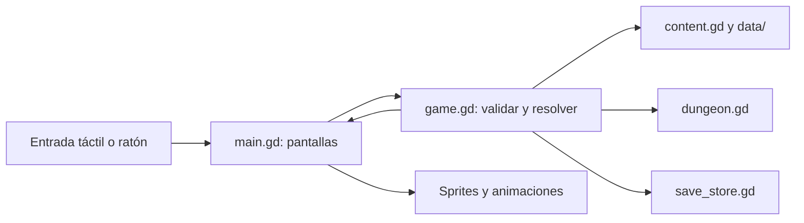

# Arquitectura y organización del código

Revisión: **17/09/2026**. Este documento distingue la estructura que existe de
la organización objetivo. Las carpetas propuestas todavía no implican una
refactorización realizada.

## 1. Arquitectura actual

| Archivo o carpeta | Responsabilidad actual |
| --- | --- |
| `main.tscn` | Escena de entrada; instancia el Control asociado a `src/main.gd` |
| `src/main.gd` | Navegación, pantallas, componentes de interfaz, opciones y coordinación de animaciones |
| `src/game.gd` | Estado de aventura/perfil, acciones, reglas, recompensas, equipamiento y coordinación del guardado |
| `src/rules/treasure.gd` | Sorteo, concesión única y daño no letal de cofres; sin UI ni persistencia |
| `src/ui/screens/treasure_screen.gd` | Cofre animado y modal; emite acciones, recibe estado ya resuelto |
| `src/ui/components/battle_background.gd` | Selección visual estable de escenario por semilla y sala, sin consumir RNG |
| `src/content.gd` | Carga de catálogos, valores de cartas mejoradas y descripciones |
| `src/dungeon.gd` | Recorrido, conexiones y encuentros determinados por semilla |
| `src/save_store.gd` | Lectura/escritura, formato versionado, archivo temporal y copia de respaldo |
| `src/*_sprite.gd` | Presentación y animaciones de personajes y enemigos |
| `src/campfire.gd`, `src/pixel_art.gd` | Fogata y gráficos dibujados en código |
| `data/` | Definiciones con identificadores estables; no contiene partidas guardadas |
| `assets/` | Recursos utilizados por el juego, organizados por personaje o sistema |
| `scripts/` | Preparación, ejecución, importación de assets, generación de datos y exportación |
| `tests/` | Reglas, interfaz, animaciones y comprobaciones de guardado |
| `docs/` | Explicaciones, decisiones, prompts, fuentes gráficas y evidencias |
| `builds/`, `.tools/` | Entregables y herramientas locales; no son código de juego |

En la revisión inicial del 15/09/2026, `main.gd` tenía **887 líneas** y `game.gd`, **493**.
Son puntos de concentración que conviene dividir. Estas cifras son una
instantánea, no límites verificados automáticamente.

### Flujo actual



La aventura se resuelve y guarda **antes** de presentar la animación. Durante
la animación se bloquean acciones duplicadas. Una interrupción no debe repetir
el daño, el consumo de un objeto ni la entrega de una recompensa.

## Extracción realizada: barra y números (16/09/2026)

Ya existen `src/ui/components/combat_hud.gd` y `number_view.gd`. La barra recibe
datos y emite señales; el contador compone dígitos a partir de un entero.
`main.gd` conserva la conexión a reglas y navegación; se retiraron de él la barra,
los iconos de reliquias y el panel de energía. No se ha extraído aún toda la
pantalla de combate. Ver [contratos y assets](hud/README.md).

## Extracción realizada: equipamiento y bloqueo (16/09/2026)

- `src/ui/screens/equipment_screen.gd`: construye selección de reliquia compartida
  con datos y callbacks explícitos. Reutiliza la fábrica visual de `main.gd`
  durante la transición; no accede a reglas ni persistencia.
- `src/ui/components/block_indicator.gd`: escudo y dígitos, solo presentación.
- `main.gd`: reemplaza la elección, guarda preparación y conecta callbacks.
- `game.gd::valid_equipment`: límite de una asignación para nuevas aventuras;
  la carga mantiene aventuras antiguas sin migrar sus estadísticas.

## 2. Organización objetivo

Crear carpetas al extraer responsabilidades reales; no crear directorios vacíos
ni capas adicionales que todavía no se necesiten.

```text
main.tscn                       # Entrada estable durante la transición
src/
  main.gd                      # Composición, navegación y ciclo de vida
  game.gd                      # API pública de acciones y estado
  content.gd                   # Acceso al catálogo
  dungeon.gd                   # Generación del recorrido
  save_store.gd                # Persistencia
  ui/
    screens/
      home_screen.gd
      options_screen.gd
      base_camp_screen.gd
      selection_screen.gd
      equipment_screen.gd
      map_screen.gd
      combat_screen.gd
      items_screen.gd
      reward_screen.gd
      room_screen.gd
      deck_screen.gd
      collection_screen.gd
      result_screen.gd
    components/
      card_view.gd
      health_bar.gd
      combat_target.gd
      object_icon.gd
      modal_dialog.gd
    theme.gd                   # Paleta y estilos compartidos
  presentation/
    actors/                    # Sprites y sus animaciones
    effects/                   # Fogata y efectos reutilizables
    combat_presenter.gd        # Secuencia visual de una acción resuelta
  rules/                       # Extraer desde game.gd cuando corresponda
    combat_rules.gd
    equipment_rules.gd
    reward_rules.gd
scenes/
  ui/                          # .tscn de pantallas/componentes si aportan valor
  actors/                      # Escenas reutilizables si se necesitan
```

Se puede mantener una pantalla construida por código dentro de su propio script.
Usar `.tscn` cuando facilite editar el diseño o reutilizar nodos en Godot. No
hace falta convertir todo a escenas ni trasladar archivos pequeños que ya tienen
una responsabilidad clara. Los nombres anteriores son destinos propuestos.

### Límites entre módulos

- **Pantallas:** construyen su interfaz y expresan acciones mediante señales o
  callbacks. No calculan daño, otorgan recompensas ni escriben partidas.
- **Componentes:** reciben datos para mostrar y emiten eventos. Una carta recibe
  nombre, coste, descripción y selección; no necesita conocer toda la aplicación.
- **Navegación:** decide qué pantalla abrir, gestiona Atrás y conecta pantallas
  con la API de juego. No contiene el diseño completo de cada pantalla.
- **Reglas:** validan y modifican el estado, sin depender de `Control`, sprites,
  temporizadores visuales o rutas de nodos. Deben poder probarse sin ventana.
- **Presentación:** anima resultados ya resueltos. No consume el generador
  aleatorio de la aventura ni modifica vida, mazo o inventario.
- **Persistencia:** serializa y recupera estado. No decide recompensas ni navega.
- **Datos:** describen contenido. No contienen callbacks de interfaz ni referencias
  a nodos vivos que terminen dentro del guardado.

Dirección de dependencias: interfaz → API de juego → reglas/datos/persistencia.
Los componentes visuales no importan pantallas para volver a llamarlas. Evitar
que dos módulos se necesiten mutuamente y evitar un nodo global para cada sistema.

## 3. Tamaño y responsabilidades

Son señales para revisar un archivo, no cuotas rígidas:

- Procurar una responsabilidad principal por archivo, normalmente 100–300 líneas.
- Al superar unas 350–400 líneas, revisar si mezcla pantallas, reglas o componentes.
- Si una función necesita recorrer mucho código para comprenderla (orientativamente
  más de 50–80 líneas), separar fases con nombres concretos cuando sean coherentes.
- Un catálogo generado o un test amplio puede ser mayor. Documentar la excepción
  si afecta el mantenimiento; no dividir datos artificialmente para reducir líneas.
- No comprimir código, encadenar instrucciones ni crear decenas de funciones
  triviales solo para cumplir una cifra.
- Extraer un componente cuando se reutiliza o cuando tiene comportamiento propio
  que merece aislarse. Evitar archivos genéricos `utils.gd` con funciones sin relación.

**Desde ahora:** las nuevas pantallas se crean en archivos propios. Al ampliar
una pantalla ya grande, extraer la responsabilidad afectada antes de seguir
acumulándola en `main.gd`. Las correcciones pequeñas pueden permanecer donde están;
no obligan a reorganizar todo el proyecto.

## 4. Datos, assets y convenciones

- Archivos y carpetas: `snake_case`; clases GDScript con nombres descriptivos,
  conservando el prefijo `ER` donde ya se utiliza.
- Mantener IDs de contenido estables aunque cambie el nombre visible o el sprite.
  Por ejemplo, el encuentro `rat` conserva su ID aunque muestre un murciélago.
- `scripts/create_content.py` genera `data/content.json`. Actualizar generador y
  resultado juntos cuando cambie contenido generado; no dejar cambios que la
  próxima generación vaya a borrar.
- `data/equipment.json` y `data/enemy_visuals.json` se mantienen como catálogos
  separados. No están generados por `create_content.py`, aunque este consulta
  el catálogo visual para los nombres y apariencias de enemigos.
- Conservar las imágenes usadas por el juego en `assets/<sistema>/`; originales
  generados y prompts en `docs/<sistema>/`; capturas desechables en `artifacts/`.
- Los importadores deben permitir reproducir recortes, tamaño y alineación.
  Si se necesita otra estructura de fuentes de arte, migrarla explícitamente
  junto con las rutas de esos scripts.
- Al mover scripts/escenas, conservar sus `.uid` y actualizar referencias
  `preload`, `load`, escenas, pruebas y documentación. No editar manualmente
  cachés de `.godot/` ni regenerar UIDs para ocultar referencias rotas.
- Mantener un tema compartido para colores, fuentes y estilos. Los componentes
  son responsables de sus márgenes; no repartir coordenadas internas de una
  misma carta entre varias pantallas.
- Evitar copiar un sistema completo para cada clase o mazmorra. Compartir lógica
  realmente común mediante datos, sin forzar a todos los actores a tener las
  mismas animaciones especiales.

## 5. Estado y compatibilidad

`ERGame` sigue siendo el punto de entrada para acciones como `new_run`,
`play_card`, `end_turn` y `use_item` durante la extracción. Los módulos de reglas
reciben las dependencias necesarias de forma explícita; no crean otra aventura
ni otra instancia de almacenamiento por su cuenta.

- `profile`: progreso permanente, opciones y preparación previa.
- `run`: héroes, mazo, inventario, salas, combate, recompensas y estado aleatorio.
- Selección de carta, desplazamiento de la mano y animaciones son estado de interfaz.

Actualmente `profile` y `run` son **dos secciones de un mismo archivo atómico**,
`user://eterno.save`, con formato versión 1 y respaldo `.bak`. No son dos archivos
independientes. Preservar esta atomicidad para evitar recompensas duplicadas.

Una reorganización de archivos no justifica cambiar el formato del guardado.
Campos nuevos deben tener valores por defecto compatibles; cambios incompatibles
requieren migración explícita y pruebas de lectura de partidas anteriores.

## 6. Refactorización incremental propuesta

1. Extraer tema, `card_panel`, barra de vida, iconos y modal. Comprobar mazo,
   recompensas y combate, pues comparten componentes.
2. Extraer inicio/opciones y campamentos, después selección/equipamiento. Mantener
   navegación y guardado de preparación.
3. Extraer combate y su barra/mano/objetivos; separar la secuencia visual en un
   presentador. Mantener el orden resolver → guardar → animar → actualizar vista.
4. Extraer las demás pantallas. Dejar `main.gd` como coordinador pequeño.
5. Separar reglas de combate, equipamiento y recompensas cuando sus límites estén
   claros, conservando la API pública de `ERGame`.

Cada paso debe funcionar por sí mismo. Evitar mezclar una extracción grande con
cambios de estadísticas, arte o formato de guardado: así es posible identificar
qué causó una regresión. No se ha ejecutado esta reorganización en esta entrega.

## 7. Comprobaciones al reorganizar

- Revisar importación y referencias de Godot después de mover recursos.
- Ejecutar las pruebas de reglas para cambios de lógica y las pruebas de la
  pantalla/componente afectado para cambios de interfaz.
- Probar carga de una aventura, continuación de combate y recompensa pendiente
  cuando se toquen dependencias del guardado.
- Revisar renderizado, selección, objetivos, Atrás y bloqueo durante animaciones.
  Las pruebas headless no prueban legibilidad ni interacción en Android.
- Adaptar pruebas acopladas a la estructura antigua sin eliminar las comprobaciones
  de comportamiento. Preferir nombres/señales estables a coordenadas o índices
  de hijos cuando sea posible.
- Actualizar este mapa y [el historial](HISTORIAL.md) con los movimientos realmente
  realizados. No presentar la estructura objetivo como implementada.
- No compilar APK salvo pedido explícito del usuario.

## Componentes visuales del HUD (16/09/2026, revisión posterior)

- `src/ui/components/relic_popover.gd`: cuadro anclado, únicamente presentación.
- `combat_hud.gd`: apertura, sustitución y cierre del cuadro; captura del toque
  exterior. El controlador mantiene el bloqueo de acciones durante animaciones.
- `assets/ui/shaders/energy_flow.gdshader`: movimiento procedural del interior
  del orbe; contador separado para mantener el texto estable.
- `main.gd`: conecta la petición de información y delega Atrás; escala de los
  actores de combate reducida a 1. Sin modificaciones en reglas ni guardado.

## Reliquia compartida (16/09/2026)

La pantalla de equipamiento recibe catálogo, elección y callbacks; ya no recibe
héroes ni portador. El controlador guarda una clave `team` y el motor registra
`run.team_relic`, además del ID por actor para reutilizar efectos. La energía
compartida se cuenta una sola vez. El HUD presenta un único icono de equipo.
Guardados sin ese campo conservan el comportamiento personal anterior.

## Fila de estados activos (16/09/2026)

`src/ui/components/status_effects.gd` recibe una instantánea del actor y compone
solo bloqueo/veneno positivos para actores vivos. Reutiliza `block_indicator.gd`
con textura configurable; no calcula efectos ni guarda estado. La calavera
vectorial está en `assets/ui/poison.svg`. `main.gd` únicamente coloca la fila
para ambos bandos y conserva la coordinación de la pantalla.

## Barra de vida con presentación diferida (16/09/2026)

`src/ui/components/health_bar.gd` reemplaza los ColorRect/Label creados en
`main.gd`. Recibe vida/máximo y un objetivo visual; emite `value_changed` y
`animation_finished`. No cambia unidades ni guarda. El controlador registra
barras por índice de héroe/enemigo, conserva el escenario anterior mientras
reaccionan los actores y espera todos los contadores antes de `continue_run()`.
La resolución y persistencia permanecen antes de cualquier espera visual.


## Atlas de actores de 128 px y movimiento enemigo (16/09/2026)

- Importadores existentes de héroes/selección/biblioteca ahora producen recursos
  de 128 px desde originales grandes. Atlas antiguos de 64 px retirados en la limpieza.
- `src/*_sprite.gd`: héroes recortan 128 px y compensan escala y línea base.
- `src/enemy_sprite.gd`: usa atlas de ocho poses si existe en
  `assets/enemies/animations/`; si no, sprite de `assets/enemies/hd/`.
  Mismo contrato público `play_once`/`set_fallen`, sin acceso a reglas.
- `scripts/import_enemy_animations.gd`: recorte, escala uniforme y anclajes de
  los seis ciclos nuevos. `scripts/preview_actors.gd`: herramienta de desarrollo
  separada de la interfaz del juego.
- Fuentes y prompts en `docs/enemies/animations/`; explicación y validación
  actuales en [quality/README.md](quality/README.md). Sin cambios de IDs/guardados.

## Limpieza y salidas de desarrollo (16/09/2026)

`tests/artifacts.gd` centraliza destinos de capturas en `artifacts/<sistema>/`.
La carpeta se crea bajo demanda con `.gdignore`, está ignorada por Git y excluida
de exportaciones. `docs/` conserva texto y fuentes que permiten reimportar assets.
`src/pixel_art.gd` conserva su UID y solo dibuja el fondo procedural usado por
mapa, recompensas y colección; se retiraron los personajes dibujados en bloques.
Los seis héroes siempre usan sus componentes animados. Sin cambios de IDs ni guardados.

## Extracción terminada: mapa de aventura (16/09/2026)

- `src/ui/screens/map_screen.gd`: fondo, rutas, iconos de salas, héroes/PV,
  lista desplazable de reliquias y navegación. Recibe instantáneas; emite señales.
- `main.gd::map_view()`: coordina datos y acciones; retirados diseño anterior y
  `map_hero()`. `equipped_relics()` prepara el mismo alcance/estado de reliquia
  para mapa y combate, preservando equipos personales legados.
- `assets/map/`: fondo y atlas final de seis iconos, recortado en ejecución.
- Reglas de avance, resolución y persistencia permanecen en `game.gd`.

## Presentación de intención, tipos de carta y salida (16/09/2026)

- `ui/components/enemy_intent.gd`: instantánea de intención y héroes; iconos,
  números existentes y caras desde atlas frontal, sin tocar reglas.
- `ui/components/card_type_icons.gd`: añade iconos según daño/veneno/bloqueo.
- `presentation/combat_effects.gd`: flash y carrera de salida procedural;
  no importa `Game`, no escribe guardados ni modifica unidades.
- `main.gd` coordina resolver/guardar → ataques/reacciones/PV → salida si hay
  recompensa → navegación. `combat_busy` permanece activo durante la salida.

## Distribución de la mano (16/09/2026)

`src/ui/components/hand_layout.gd` calcula anchura del contenido, posición,
pivote y rotación del abanico. `main.gd` conserva la construcción compartida
 de cartas y conecta la selección. No interviene en reglas ni guardado.

## Resplandor de objetivos y botón de turno (16/09/2026)

`ui/components/target_glow.gd` añade un halo detrás del actor elegible con
`assets/ui/shaders/target_glow.gdshader`; la decisión sigue en `valid_targets()`.
`ui/components/end_turn_button.gd` decora el botón que conecta `main.gd` a la acción.
Ambos componentes son presentación; no guardan ni modifican estado de combate.

## Mercado y economía persistente (16/09/2026)

Extracción terminada del campamento a `src/ui/screens/base_camp_screen.gd`;
mercado nuevo en `src/ui/screens/market_screen.gd`. Ambas vistas reciben datos
y callbacks, reutilizan la fábrica visual existente y no conceden compras.
`src/rules/camp_progression.gd` concentra costes, migración y disponibilidad;
`game.gd` coordina el guardado atómico. `main.gd` conecta navegación y acciones.
`data/progression.json` configura economía y entrega de pruebas;
`data/additional_cards.json` alimenta el generador del catálogo.
La extracción completa de la fábrica visual de main sigue pendiente.
[Contratos de perfil/run y pruebas](market/README.md).

## Sinergias (16/09/2026)

`data/synergies.json` declara recetas separadas del catálogo de cartas.
`rules/card_synergies.gd` calcula posibilidades sin mutaciones; Game valida
objetivos/energía y resuelve descartes, efectos, victoria y guardado.
`ui/components/synergy_view.gd` presenta señales y efectos sin calcular daño.
Main coordina selección y reutiliza la animación posterior al checkpoint.
No se agregan campos persistentes: la mano guardada determina las oportunidades.
[Contrato y recetas](synergies/README.md).

## Ilustraciones de cartas (16/09/2026)

`data/card_art.json` separa asignaciones visuales del catálogo de reglas.
`ui/components/card_art.gd` carga texturas con caché y usa regiones de atlas para
las 30 ilustraciones originales. La fábrica de cartas y el mercado lo consumen
sin duplicar lógica. Las imágenes no interceptan entrada ni modifican estado.
[Fuentes y mantenimiento](cards/art/README.md).

## Extracción terminada: diálogos y saldo del campamento (17/09/2026)

- `ui/components/dialog_view.gd`: construye el cuadro de acciones y su contenido;
  recibe callbacks y estados habilitados, sin decidir navegación ni guardar.
- `ui/components/modal_frame.gd`: decoración compartida para diálogos y tesoros.
- `ui/components/soul_counter.gd`: muestra una cantidad con icono y `number_view.gd`.
- `main.gd` delega la presentación de `show_modal` y conecta las tres acciones
  del arco. Mantiene confirmación de nueva aventura y continuidad del guardado.
- Campamento y mercado reciben instantáneas del perfil; mapa y HUD ya no reciben
  almas. Construcción, costes y concesiones siguen en las reglas existentes.

No cambia el formato de guardado. El edificio se dibuja según `profile.buildings.market`.

## Extracción terminada: selección y botones (17/09/2026)

- `ui/screens/selection_screen.gd`: presentación de pareja, fogata y panel inferior;
  extraída de `main.gd`. Los callbacks conservan navegación y guardado en el controlador.
- `ui/components/preparation_header.gd`: barra común de campamento, personajes y
  equipamiento. El saldo es opcional y se pasa exclusivamente desde campamento.
- `ui/components/button_skin.gd`: tema raster compartido, estados y regiones de
  textura. Las superficies con assets específicos mantienen sus overrides.
- Recursos y procedencia en `assets/ui/buttons/` y `docs/ui_buttons/`.

### Elección circular de reliquias (17/09/2026)

`equipment_screen.gd` recibe el callback `equip` y muestra iconos en círculo.
`main.gd::equip_relic` selecciona y guarda inmediatamente.
`ui/components/equipment_description.gd` presenta el efecto persistente fuera
del círculo, sin overlay ni acciones. Se retiró `inspect_equipment` al eliminar
la confirmación modal. La vista no modifica el perfil.

### Botón circular y mano de combate (17/09/2026)

`ui/components/round_button.gd` limita hit testing al círculo. `end_turn_button.gd`
lo aplica junto al asset y estados, sin resolver turnos. `hand_layout.gd` mantiene
cálculos de abanico y selección; `main.gd` conserva acciones y coordinación.
