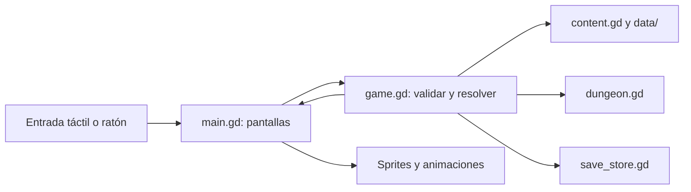

# Arquitectura y organización del código

Revisión: **15/09/2026**. Este documento distingue la estructura que existe de
la organización objetivo. Las carpetas propuestas todavía no implican una
refactorización realizada.

## 1. Arquitectura actual

| Archivo o carpeta | Responsabilidad actual |
| --- | --- |
| `main.tscn` | Escena de entrada; instancia el Control asociado a `src/main.gd` |
| `src/main.gd` | Navegación, pantallas, componentes de interfaz, opciones y coordinación de animaciones |
| `src/game.gd` | Estado de aventura/perfil, acciones, reglas, recompensas, equipamiento y coordinación del guardado |
| `src/content.gd` | Carga de catálogos, valores de cartas mejoradas y descripciones |
| `src/dungeon.gd` | Recorrido, conexiones y encuentros determinados por semilla |
| `src/save_store.gd` | Lectura/escritura, formato versionado, archivo temporal y copia de respaldo |
| `src/*_sprite.gd` | Presentación y animaciones de personajes y enemigos |
| `src/campfire.gd`, `src/pixel_art.gd` | Fogata y gráficos dibujados en código |
| `data/` | Definiciones con identificadores estables; no contiene partidas guardadas |
| `assets/` | Recursos utilizados por el juego, organizados por personaje o sistema |
| `scripts/` | Preparación, ejecución, importación de assets, generación de datos y exportación |
| `tests/` | Reglas, interfaz, animaciones y comprobaciones de guardado |
| `docs/` | Explicaciones, decisiones, prompts, fuentes gráficas y evidencias |
| `builds/`, `.tools/` | Entregables y herramientas locales; no son código de juego |

Al revisar este documento, `main.gd` tiene **887 líneas** y `game.gd`, **493**.
Son puntos de concentración que conviene dividir. Estas cifras son una
instantánea, no límites verificados automáticamente.

### Flujo actual



La aventura se resuelve y guarda **antes** de presentar la animación. Durante
la animación se bloquean acciones duplicadas. Una interrupción no debe repetir
el daño, el consumo de un objeto ni la entrega de una recompensa.

## 2. Organización objetivo

Crear carpetas al extraer responsabilidades reales; no crear directorios vacíos
ni capas adicionales que todavía no se necesiten.

```text
main.tscn                       # Entrada estable durante la transición
src/
  main.gd                      # Composición, navegación y ciclo de vida
  game.gd                      # API pública de acciones y estado
  content.gd                   # Acceso al catálogo
  dungeon.gd                   # Generación del recorrido
  save_store.gd                # Persistencia
  ui/
    screens/
      home_screen.gd
      options_screen.gd
      base_camp_screen.gd
      selection_screen.gd
      equipment_screen.gd
      map_screen.gd
      combat_screen.gd
      items_screen.gd
      reward_screen.gd
      room_screen.gd
      deck_screen.gd
      collection_screen.gd
      result_screen.gd
    components/
      card_view.gd
      health_bar.gd
      combat_target.gd
      object_icon.gd
      modal_dialog.gd
    theme.gd                   # Paleta y estilos compartidos
  presentation/
    actors/                    # Sprites y sus animaciones
    effects/                   # Fogata y efectos reutilizables
    combat_presenter.gd        # Secuencia visual de una acción resuelta
  rules/                       # Extraer desde game.gd cuando corresponda
    combat_rules.gd
    equipment_rules.gd
    reward_rules.gd
scenes/
  ui/                          # .tscn de pantallas/componentes si aportan valor
  actors/                      # Escenas reutilizables si se necesitan
```

Se puede mantener una pantalla construida por código dentro de su propio script.
Usar `.tscn` cuando facilite editar el diseño o reutilizar nodos en Godot. No
hace falta convertir todo a escenas ni trasladar archivos pequeños que ya tienen
una responsabilidad clara. Los nombres anteriores son destinos propuestos.

### Límites entre módulos

- **Pantallas:** construyen su interfaz y expresan acciones mediante señales o
  callbacks. No calculan daño, otorgan recompensas ni escriben partidas.
- **Componentes:** reciben datos para mostrar y emiten eventos. Una carta recibe
  nombre, coste, descripción y selección; no necesita conocer toda la aplicación.
- **Navegación:** decide qué pantalla abrir, gestiona Atrás y conecta pantallas
  con la API de juego. No contiene el diseño completo de cada pantalla.
- **Reglas:** validan y modifican el estado, sin depender de `Control`, sprites,
  temporizadores visuales o rutas de nodos. Deben poder probarse sin ventana.
- **Presentación:** anima resultados ya resueltos. No consume el generador
  aleatorio de la aventura ni modifica vida, mazo o inventario.
- **Persistencia:** serializa y recupera estado. No decide recompensas ni navega.
- **Datos:** describen contenido. No contienen callbacks de interfaz ni referencias
  a nodos vivos que terminen dentro del guardado.

Dirección de dependencias: interfaz → API de juego → reglas/datos/persistencia.
Los componentes visuales no importan pantallas para volver a llamarlas. Evitar
que dos módulos se necesiten mutuamente y evitar un nodo global para cada sistema.

## 3. Tamaño y responsabilidades

Son señales para revisar un archivo, no cuotas rígidas:

- Procurar una responsabilidad principal por archivo, normalmente 100–300 líneas.
- Al superar unas 350–400 líneas, revisar si mezcla pantallas, reglas o componentes.
- Si una función necesita recorrer mucho código para comprenderla (orientativamente
  más de 50–80 líneas), separar fases con nombres concretos cuando sean coherentes.
- Un catálogo generado o un test amplio puede ser mayor. Documentar la excepción
  si afecta el mantenimiento; no dividir datos artificialmente para reducir líneas.
- No comprimir código, encadenar instrucciones ni crear decenas de funciones
  triviales solo para cumplir una cifra.
- Extraer un componente cuando se reutiliza o cuando tiene comportamiento propio
  que merece aislarse. Evitar archivos genéricos `utils.gd` con funciones sin relación.

**Desde ahora:** las nuevas pantallas se crean en archivos propios. Al ampliar
una pantalla ya grande, extraer la responsabilidad afectada antes de seguir
acumulándola en `main.gd`. Las correcciones pequeñas pueden permanecer donde están;
no obligan a reorganizar todo el proyecto.

## 4. Datos, assets y convenciones

- Archivos y carpetas: `snake_case`; clases GDScript con nombres descriptivos,
  conservando el prefijo `ER` donde ya se utiliza.
- Mantener IDs de contenido estables aunque cambie el nombre visible o el sprite.
  Por ejemplo, el encuentro `rat` conserva su ID aunque muestre un murciélago.
- `scripts/create_content.py` genera `data/content.json`. Actualizar generador y
  resultado juntos cuando cambie contenido generado; no dejar cambios que la
  próxima generación vaya a borrar.
- `data/equipment.json` y `data/enemy_visuals.json` se mantienen como catálogos
  separados. No están generados por `create_content.py`, aunque este consulta
  el catálogo visual para los nombres y apariencias de enemigos.
- Conservar las imágenes usadas por el juego en `assets/<sistema>/`; originales
  generados, prompts y capturas de revisión en `docs/<sistema>/` por ahora.
- Los importadores deben permitir reproducir recortes, tamaño y alineación.
  Si se necesita otra estructura de fuentes de arte, migrarla explícitamente
  junto con las rutas de esos scripts.
- Al mover scripts/escenas, conservar sus `.uid` y actualizar referencias
  `preload`, `load`, escenas, pruebas y documentación. No editar manualmente
  cachés de `.godot/` ni regenerar UIDs para ocultar referencias rotas.
- Mantener un tema compartido para colores, fuentes y estilos. Los componentes
  son responsables de sus márgenes; no repartir coordenadas internas de una
  misma carta entre varias pantallas.
- Evitar copiar un sistema completo para cada clase o mazmorra. Compartir lógica
  realmente común mediante datos, sin forzar a todos los actores a tener las
  mismas animaciones especiales.

## 5. Estado y compatibilidad

`ERGame` sigue siendo el punto de entrada para acciones como `new_run`,
`play_card`, `end_turn` y `use_item` durante la extracción. Los módulos de reglas
reciben las dependencias necesarias de forma explícita; no crean otra aventura
ni otra instancia de almacenamiento por su cuenta.

- `profile`: progreso permanente, opciones y preparación previa.
- `run`: héroes, mazo, inventario, salas, combate, recompensas y estado aleatorio.
- Selección de carta, desplazamiento de la mano y animaciones son estado de interfaz.

Actualmente `profile` y `run` son **dos secciones de un mismo archivo atómico**,
`user://eterno.save`, con formato versión 1 y respaldo `.bak`. No son dos archivos
independientes. Preservar esta atomicidad para evitar recompensas duplicadas.

Una reorganización de archivos no justifica cambiar el formato del guardado.
Campos nuevos deben tener valores por defecto compatibles; cambios incompatibles
requieren migración explícita y pruebas de lectura de partidas anteriores.

## 6. Refactorización incremental propuesta

1. Extraer tema, `card_panel`, barra de vida, iconos y modal. Comprobar mazo,
   recompensas y combate, pues comparten componentes.
2. Extraer inicio/opciones y campamentos, después selección/equipamiento. Mantener
   navegación y guardado de preparación.
3. Extraer combate y su barra/mano/objetivos; separar la secuencia visual en un
   presentador. Mantener el orden resolver → guardar → animar → actualizar vista.
4. Extraer las demás pantallas. Dejar `main.gd` como coordinador pequeño.
5. Separar reglas de combate, equipamiento y recompensas cuando sus límites estén
   claros, conservando la API pública de `ERGame`.

Cada paso debe funcionar por sí mismo. Evitar mezclar una extracción grande con
cambios de estadísticas, arte o formato de guardado: así es posible identificar
qué causó una regresión. No se ha ejecutado esta reorganización en esta entrega.

## 7. Comprobaciones al reorganizar

- Revisar importación y referencias de Godot después de mover recursos.
- Ejecutar las pruebas de reglas para cambios de lógica y las pruebas de la
  pantalla/componente afectado para cambios de interfaz.
- Probar carga de una aventura, continuación de combate y recompensa pendiente
  cuando se toquen dependencias del guardado.
- Revisar renderizado, selección, objetivos, Atrás y bloqueo durante animaciones.
  Las pruebas headless no prueban legibilidad ni interacción en Android.
- Adaptar pruebas acopladas a la estructura antigua sin eliminar las comprobaciones
  de comportamiento. Preferir nombres/señales estables a coordenadas o índices
  de hijos cuando sea posible.
- Actualizar este mapa y [el historial](HISTORIAL.md) con los movimientos realmente
  realizados. No presentar la estructura objetivo como implementada.
- No compilar APK salvo pedido explícito del usuario.
